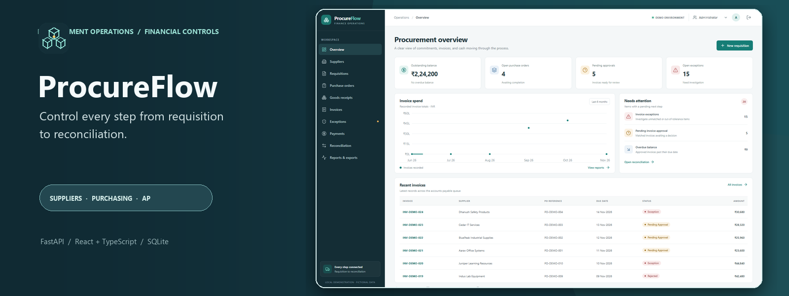
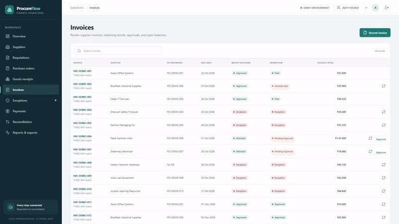
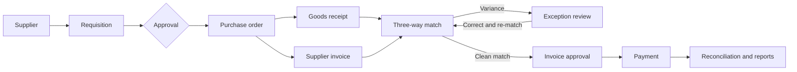
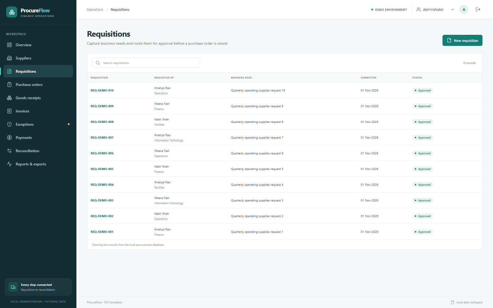
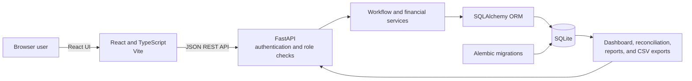

<p align="center">
  
</p>

<p align="center">
  
</p>

<h1 align="center">ProcureFlow</h1>

<p align="center"><strong>Control every step from requisition to reconciliation.</strong><br>A locally runnable ERP Procure-to-Pay simulation built around practical procurement and accounts-payable controls.</p>

<p align="center">
  <a href="https://github.com/Aadersh2996/procureflow-p2p/actions/workflows/ci.yml"></a>
  
  
  
  
  
</p>

<p align="center">
  <a href="docs/demo/ProcureFlow_Demo.mp4"><strong>Watch the 3:27 demo</strong></a> ·
  <a href="docs/demo/DEMO_WALKTHROUGH.md">Walkthrough and data notes</a> ·
  <a href="#application-gallery">Screenshot gallery</a>
</p>

<p align="center"></p>

## Contents

- [Business context](#business-context)
- [Workflow](#procure-to-pay-workflow)
- [Three-way match and controls](#three-way-match-and-controls)
- [Application gallery](#application-gallery)
- [Architecture and data](#architecture-and-data)
- [SQL reporting](#sql-reporting)
- [Run on Windows](#run-locally-on-windows)
- [Testing](#testing-and-quality)
- [Simulation boundaries](#simulation-boundaries)

## Business context

Procure-to-Pay work crosses requesters, procurement, receiving, approvers, and accounts payable. A requisition can be approved while its purchase order is still open; delivered quantities can differ from what was ordered; invoices can contain price or quantity variances; and partial payments must reconcile to the amount due. ProcureFlow connects those records so the next action and outstanding balance can be reviewed from persisted business data.

This is an independent educational portfolio project using fictional Indian suppliers and INR. It is **not Oracle Fusion, an Oracle-certified product, or an Oracle integration**.

## Procure-to-Pay workflow



### What the application demonstrates

- Supplier registration, search, tax identifiers, CSV exchange, and linked transaction history.
- Requisition submission and approval, followed by linked purchase orders and release decisions.
- Goods receipt entry with received, accepted, and rejected quantities kept distinct.
- Invoice capture with two-way and three-way match outcomes, duplicate prevention, and exception history.
- Role-checked approval and payment actions with business audit events.
- Partial and full payments, overpayment prevention, and reconciliation from stored payment rows.
- Database-backed dashboard metrics, operational reports, CSV exports, and executable SQL examples.

## Three-way match and controls

For a three-way match, ProcureFlow compares an invoice with its linked purchase order and the cumulative accepted quantities on goods receipts. Checks include supplier and document relationships, unit price, cumulative ordered and invoiced quantities, accepted receipt quantities, cumulative invoice value against PO value, duplicate supplier invoice numbers, and line-level GST arithmetic.

For example, demo transaction `INV-DEMO-006` references `PO-DEMO-006`. The PO has 10 units, the accepted receipt has 10 units, and the invoice bills 8 units at the PO line price. That invoice passes matching and awaits approval. The demo also shows the open price variance for `INV-DEMO-005`; it remains open and is not represented as resolved.

There is no configurable tolerance policy: price and quantity comparisons are exact. Correcting source invoice details and rerunning the match is required before an invoice with a prior exception can pass. Resolving an exception alone does not approve an invoice.

### Financial controls

- INR amounts are stored as integer paise; quantities use integer milliunits; GST rates use basis points.
- Decimal arithmetic with half-up rounding is used for line extensions and GST.
- Payments are accepted only against approved invoices and cannot exceed the unpaid balance.
- Reconciliation recomputes paid and open balances from persisted payment rows.
- Approval, matching, exception, and payment actions retain local audit history.

In the recorded isolated demo, `INV-DEMO-002` totals ₹25,960. It starts with ₹12,980 paid; a further ₹12,980 NEFT payment settles the balance. The recorded payment reference and scenario are documented in the [walkthrough](docs/demo/DEMO_WALKTHROUGH.md).

## Application gallery

Screenshots below were captured from the running application with fictional seed records. The matching preview is a real clip from the verified browser recording.

<table>
  <tr>
    <td align="center"><strong>Dashboard</strong><br></td>
    <td align="center"><strong>Supplier directory</strong><br></td>
  </tr>
  <tr>
    <td align="center"><strong>Requisitions</strong><br></td>
    <td align="center"><strong>Purchase orders</strong><br></td>
  </tr>
  <tr>
    <td align="center"><strong>Goods receipts</strong><br></td>
    <td align="center"><strong>Invoice register</strong><br></td>
  </tr>
  <tr>
    <td align="center"><strong>Successful three-way match</strong><br></td>
    <td align="center"><strong>Exception management</strong><br></td>
  </tr>
  <tr>
    <td align="center"><strong>Payments</strong><br></td>
    <td align="center"><strong>Reconciliation</strong><br></td>
  </tr>
</table>

## Architecture and data



### Technology

- **Frontend:** React, TypeScript, Vite, React Router, TanStack Query, Recharts, Lucide.
- **Backend:** Python, FastAPI, Pydantic, SQLAlchemy 2, Alembic.
- **Storage:** SQLite; amounts use paise, quantities use thousandths, and tax rates use basis points.
- **Quality:** Pytest, HTTPX, Vitest, React Testing Library, Playwright, and Oxlint.

### Database design

Core entities include suppliers and users; requisitions and lines; purchase orders and lines; goods receipts and lines; invoices and lines; exceptions; approvals; payments; and audit events. Foreign keys connect workflow records. Payment rows are the source for cumulative paid balances. See [database design](docs/DATABASE_DESIGN.md) for relationships and migration notes.

## SQL reporting

The repository includes 16 SQLite reports for duplicate and unmatched invoices, price and quantity variances, PO and receipt exposure, pending approvals, overdue payables, supplier expenditure, partial payments, and reconciliation. This example derives outstanding balances from the payment ledger:

```sql
WITH paid AS (
  SELECT invoice_id, SUM(amount_paise) AS paid_paise
  FROM payments
  GROUP BY invoice_id
)
SELECT i.number, s.name AS supplier,
       i.total_paise,
       COALESCE(paid.paid_paise, 0) AS paid_paise,
       i.total_paise - COALESCE(paid.paid_paise, 0) AS outstanding_paise
FROM invoices i
JOIN suppliers s ON s.id = i.supplier_id
LEFT JOIN paid ON paid.invoice_id = i.id
WHERE i.status IN ('APPROVED', 'PARTIALLY_PAID')
  AND i.total_paise > COALESCE(paid.paid_paise, 0);
```

See [SQL report notes](docs/SQL_REPORTS.md) and [`database/sql/reports.sql`](database/sql/reports.sql). The application has operational reports and CSV exports, not an interactive SQL console.

## Run locally on Windows

### Requirements

- Windows 10 or 11 with PowerShell.
- Python 3.11 or newer.
- Node.js 20.19+ or 22.12+ and npm.

From the repository folder:

```powershell
Set-ExecutionPolicy -Scope Process -ExecutionPolicy Bypass
.\scripts\start-dev.ps1
```

The script creates `backend\.venv`, installs pinned backend dependencies, applies Alembic migrations, seeds fictional data when the database is empty, and starts the API and Vite development server. Open <http://127.0.0.1:5173>. API health is available at <http://127.0.0.1:8000/api/health>.

Demo roles are `admin`, `requester`, `procurement`, `receiving`, `ap`, `approver`, and `viewer`; passwords are `demo-<role>` (for example, `demo-admin`). These intentionally simple credentials are for offline fictional evaluation only and must not be reused.

If `P2P_SESSION_SECRET` is not set, the API creates a random process-local signing key, so sessions end when the backend restarts. To retain sessions between restarts, set a private value in the process environment before startup. `.env.example` contains placeholders; project scripts do not load it automatically.

Stop the application with:

```powershell
.\scripts\stop-dev.ps1
```

The local SQLite database is `p2p.db` and is excluded from Git. **Reset replaces its records.** Stop the app and preserve any data you need before running:

```powershell
.\scripts\reset-demo-data.ps1
```

## Testing and quality

Run backend tests:

```powershell
Set-Location .\backend
.\.venv\Scripts\python.exe -m pytest -q
```

Run frontend tests, lint, and production build:

```powershell
Set-Location ..\frontend
npm ci
npm test
npm run lint
npm run build
```

The Playwright end-to-end flow exercises the browser against a real local API and creates records named `Juniper E2E ...`. Run it against a disposable database if you want to preserve local demo data. Start the app first, then from `frontend` run:

```powershell
npm run test:e2e
```

The release was locally verified with **57 backend tests**, **18 frontend tests**, a successful lint and production build, and **one complete Playwright end-to-end flow** against an isolated SQLite copy. Pytest reports one upstream Starlette/AnyIO deprecation warning. See the [test cases](docs/TEST_CASES.md) for the business scenarios.

## Documentation

- [Business process](docs/BUSINESS_PROCESS.md)
- [Process flow](docs/PROCESS_FLOW.md)
- [ERP concepts](docs/ERP_CONCEPTS.md)
- [Three-way matching and financial rules](docs/THREE_WAY_MATCHING.md)
- [Database design](docs/DATABASE_DESIGN.md)
- [SQL reports](docs/SQL_REPORTS.md)
- [Test cases](docs/TEST_CASES.md)
- [Known limitations](docs/KNOWN_LIMITATIONS.md)
- [Demo walkthrough](docs/demo/DEMO_WALKTHROUGH.md)

## Simulation boundaries

ProcureFlow is a local educational simulation, not a production accounting platform. It uses one local SQLite database and one INR currency. It does not provide a general ledger, accounting period close, external identity provider, MFA, bank integration, GST filing, supplier communication, OCR, configurable approval matrices, or multi-company processing. GST handling is line-level arithmetic; tax jurisdiction and filing rules are outside scope. Matching uses exact comparisons without configurable tolerances. Further limitations are in [docs/KNOWN_LIMITATIONS.md](docs/KNOWN_LIMITATIONS.md).

No open-source license is included. No reuse or redistribution rights are granted unless a license is added by the project owner.
