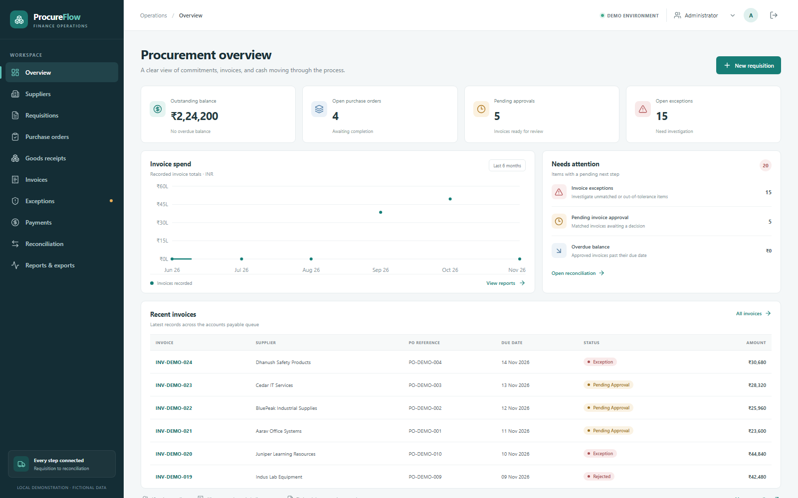
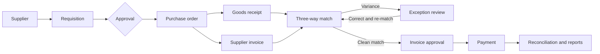
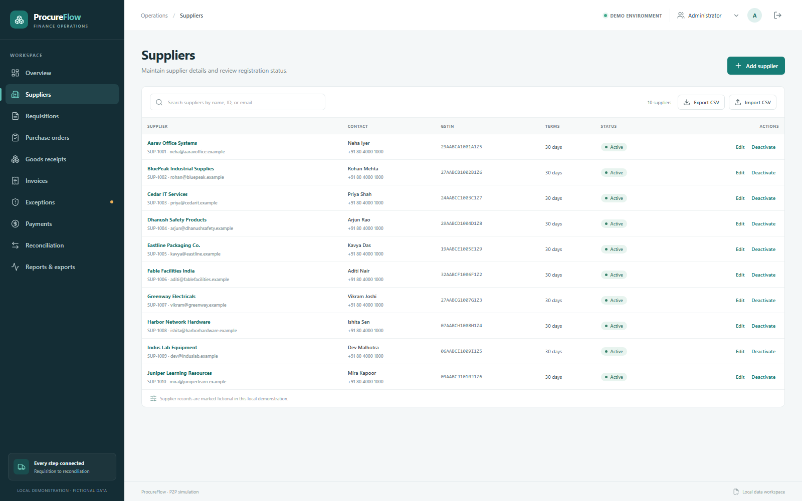
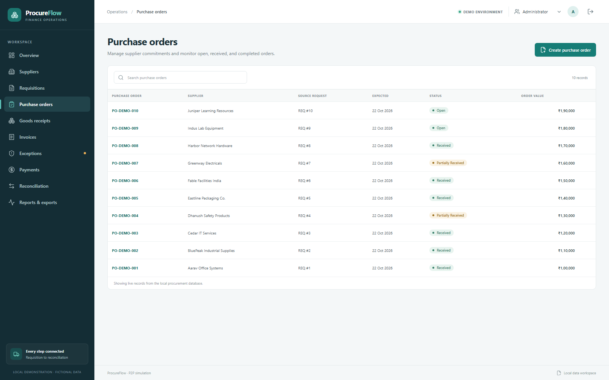
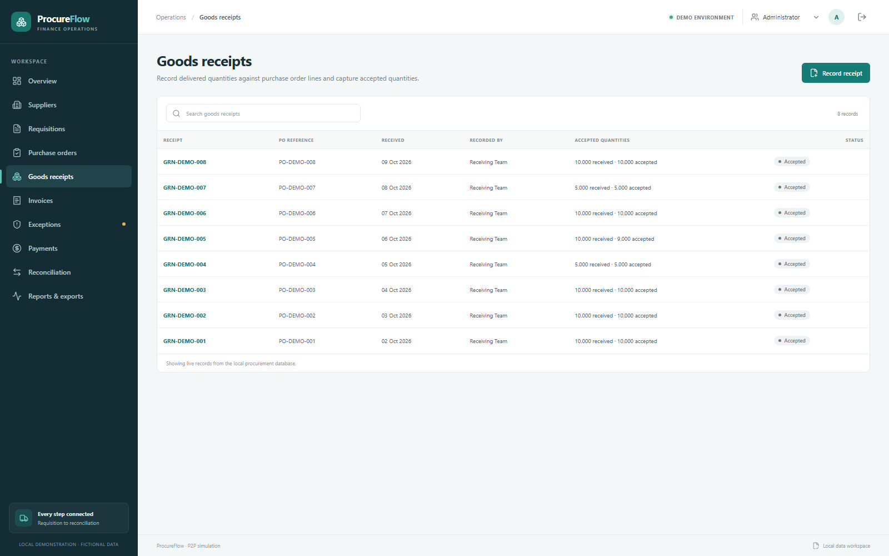
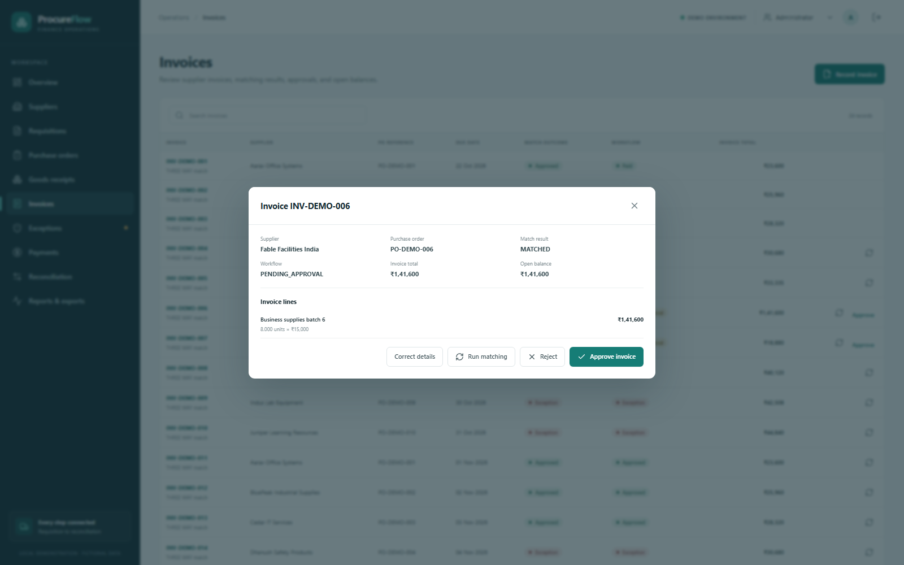
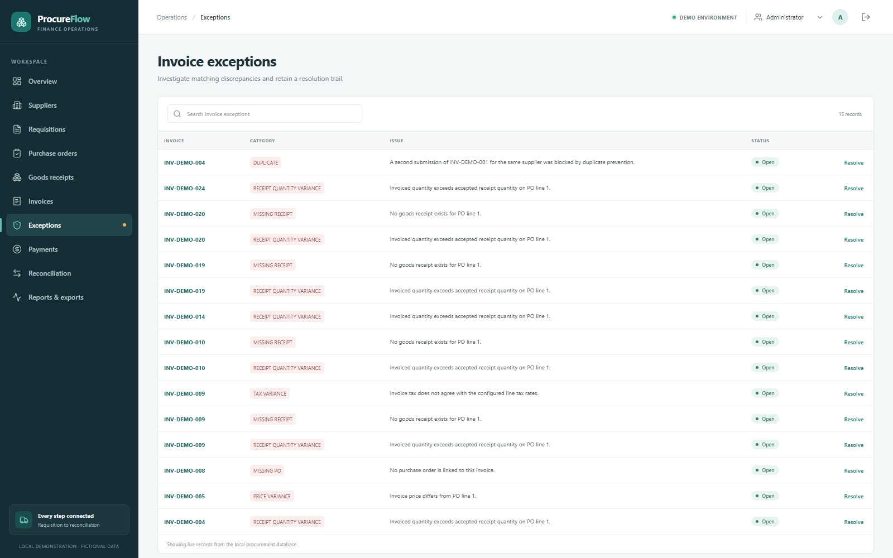
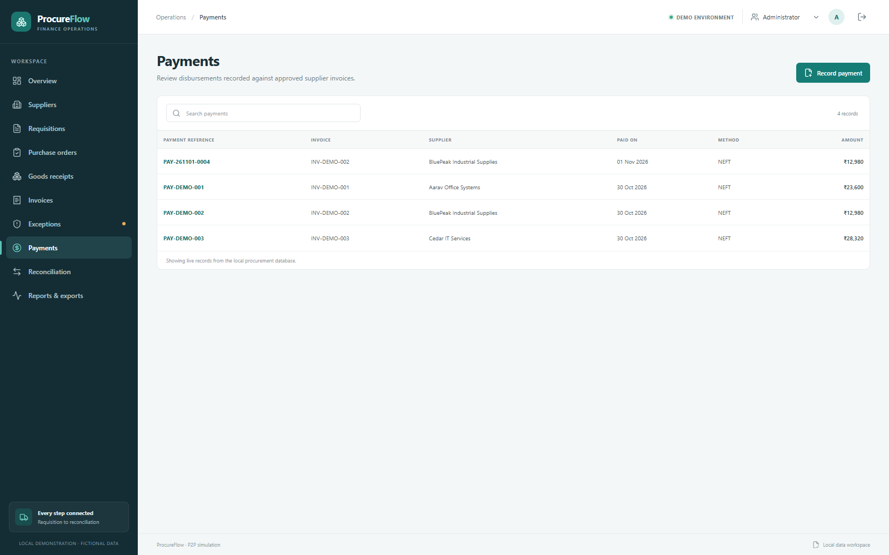
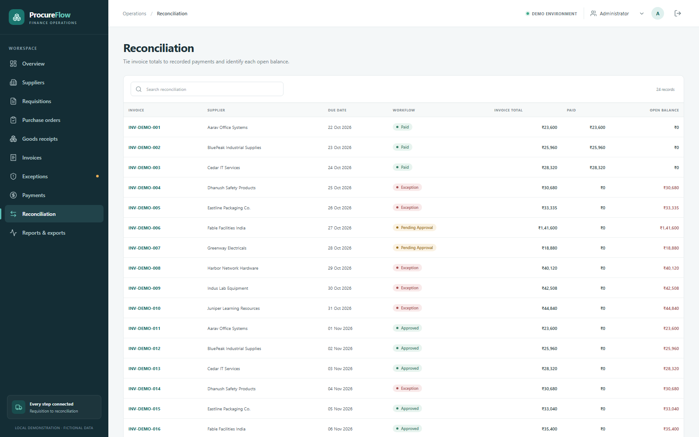
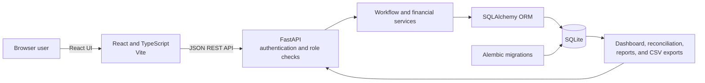

# ProcureFlow

**A locally runnable ERP Procure-to-Pay simulation** for supplier management, purchasing, receiving, invoice matching, financial controls, payments, and reconciliation.

ProcureFlow demonstrates how procurement and accounts payable records connect across a fictional Indian business using INR. It is an independent educational portfolio project. It is **not Oracle Fusion, an Oracle-certified product, or an Oracle integration**.

<p align="center"></p>

<p align="center">
  
  
  
  
</p>

## Business problem

Procure-to-Pay work crosses departments and documents. A requisition can be approved while its purchase order is still open; received goods may differ from what was ordered; supplier invoices can arrive with price or quantity variances; and partial payments must reconcile to the amount due. When those records are handled separately, it becomes harder to see what is approved, what needs investigation, and what remains payable.

## What ProcureFlow demonstrates

- Supplier records, search, status, tax identifiers, CSV exchange, and linked purchasing history.
- Requisitions with approval decisions and purchase orders linked to approved requests.
- Purchase order release and receipt tracking with received, accepted, and rejected quantities.
- Invoice capture with two-way and three-way match results, duplicate checks, and exception history.
- Role-checked approval and payment actions with an audit trail.
- Partial and full payments, overpayment prevention, and reconciliation derived from stored payment rows.
- Database-backed dashboard metrics, operational reports, CSV exports, and executable SQLite examples.

## Procure-to-Pay workflow



The application validates lifecycle transitions and procurement controls in the FastAPI backend. Resolving an exception alone does not approve an invoice; corrected invoice data must be matched again before approval.

## Three-way matching and financial controls

For a three-way match, ProcureFlow checks invoice lines against the linked purchase order and cumulative accepted quantities on goods receipts. It also checks supplier and PO relationships, unit price, cumulative ordered and invoiced quantities, PO amount, duplicate supplier invoice numbers, and line-level GST arithmetic. A failed check records an exception with its category and explanation.

Money is stored as integer paise, quantity as integer milliunits (three decimal places), and GST rates as basis points. Line extensions and tax use decimal arithmetic with half-up paise rounding. Reconciliation derives paid and open balances from persisted payment rows.

## Application screenshots

The following screenshots were captured from the running application using fictional demo records.

| Area | Screenshot |
|---|---|
| Procurement overview |  |
| Supplier management |  |
| Purchase orders |  |
| Goods receipts |  |
| Invoice matching |  |
| Exception management |  |
| Payments |  |
| Reconciliation |  |

## Demo video

[Watch the 3 minute 27 second ProcureFlow walkthrough](docs/demo/ProcureFlow_Demo.mp4). The video demonstrates the real browser application and its local API, including a payment recorded against an isolated demo database. See the [demo walkthrough and data notes](docs/demo/DEMO_WALKTHROUGH.md).

## Architecture



### Technology

- **Frontend:** React, TypeScript, Vite, React Router, TanStack Query, Recharts, Lucide.
- **Backend:** Python, FastAPI, Pydantic, SQLAlchemy 2, Alembic.
- **Data:** SQLite; INR integer paise, milliunit quantities, and basis-point tax rates.
- **Quality:** Pytest, HTTPX, Vitest, React Testing Library, and Playwright.

### Database design

Core records include `suppliers`, `user_accounts`, `requisitions` and lines, `purchase_orders` and lines, `goods_receipts` and lines, `invoices` and lines, `exceptions`, `approvals`, `payments`, and `audit_events`. Foreign keys connect the workflow documents, while payment rows remain the source for cumulative paid balances. The [database design](docs/DATABASE_DESIGN.md) describes relationships and migrations.

## SQL reporting examples

The application ships with 16 SQLite queries for duplicate and unmatched invoices, price and quantity variances, PO and receipt exposure, approvals, overdue payables, supplier expenditure, partial payments, and reconciliation. For example, this query calculates remaining balances from recorded payments:

```sql
WITH paid AS (
  SELECT invoice_id, SUM(amount_paise) AS paid_paise
  FROM payments
  GROUP BY invoice_id
)
SELECT i.number, s.name AS supplier,
       i.total_paise,
       COALESCE(paid.paid_paise, 0) AS paid_paise,
       i.total_paise - COALESCE(paid.paid_paise, 0) AS outstanding_paise
FROM invoices i
JOIN suppliers s ON s.id = i.supplier_id
LEFT JOIN paid ON paid.invoice_id = i.id
WHERE i.status IN ('APPROVED', 'PARTIALLY_PAID')
  AND i.total_paise > COALESCE(paid.paid_paise, 0);
```

See [SQL report notes](docs/SQL_REPORTS.md) and [`database/sql/reports.sql`](database/sql/reports.sql). The UI provides operational reports and CSV exports; it does not include an interactive SQL console.

## Run locally on Windows

### Requirements

- Windows 10 or 11 with PowerShell.
- Python 3.11 or newer.
- Node.js 20 or newer and npm.
- Git is optional for running the application.

From the repository folder:

```powershell
Set-ExecutionPolicy -Scope Process -ExecutionPolicy Bypass
.\scripts\start-dev.ps1
```

The script creates `backend\.venv`, installs the pinned backend dependencies, applies Alembic migrations, seeds the fictional data when the database is empty, and starts the API and Vite development server. Open <http://127.0.0.1:5173>. The API health endpoint is <http://127.0.0.1:8000/api/health>.

Use one of the demo roles: `admin`, `requester`, `procurement`, `receiving`, `ap`, `approver`, or `viewer`. Their passwords are `demo-<role>` (for example, `demo-admin`). These intentionally simple credentials are for this offline fictional simulation only; do not reuse them.

When `P2P_SESSION_SECRET` is not set, the API generates a random signing key when it starts, so signed sessions end when the server restarts. To preserve sessions across restarts, set a private local value before startup. `.env.example` lists optional environment variables as placeholders; the scripts read process environment variables and do not load that file automatically.

Stop the local processes with:

```powershell
.\scripts\stop-dev.ps1
```

The database is stored locally in `p2p.db` and is excluded from Git. The reset script permanently replaces local database records with fictional seed data. Stop the app and protect or back up any records you want to keep before running it:

```powershell
.\scripts\reset-demo-data.ps1
```

## Tests and verification

Run the backend and frontend unit/component checks and production build:

```powershell
Set-Location .\backend
.\.venv\Scripts\python.exe -m pytest -q
Set-Location ..\frontend
npm test
npm run build
npm run lint
```

The Playwright end-to-end flow exercises a real local browser and API and creates records such as `Juniper E2E ...` in the configured database. Run it against a disposable database if you need to preserve your local demo records. Start the app first, then run:

```powershell
npm run test:e2e
```

The test matrix is documented in [docs/TEST_CASES.md](docs/TEST_CASES.md). Prior acceptance evidence covers desktop, tablet, and mobile widths; the committed screenshots in this README show the desktop application.

Latest local verification: **57 backend tests passed**, **18 frontend tests passed**, the **production build passed**, the **linter passed**, and the **Playwright end-to-end procurement-to-payment flow passed** against an isolated SQLite copy. Pytest reports one upstream Starlette/AnyIO deprecation warning.

## Project documentation

- [Business process](docs/BUSINESS_PROCESS.md)
- [Process flow](docs/PROCESS_FLOW.md)
- [ERP concepts](docs/ERP_CONCEPTS.md)
- [Three-way matching and financial rules](docs/THREE_WAY_MATCHING.md)
- [Database design](docs/DATABASE_DESIGN.md)
- [SQL reports](docs/SQL_REPORTS.md)
- [Test cases](docs/TEST_CASES.md)
- [Known limitations](docs/KNOWN_LIMITATIONS.md)

## Known limitations

ProcureFlow is a local workflow simulation, not a production accounting system. It uses one SQLite database and one INR currency and does not provide a general ledger, accounting period close, external identity provider, bank integration, GST filing, supplier communication, OCR, configurable approval matrices, or multi-company processing. GST handling is line-level arithmetic; tax jurisdiction and filing rules are out of scope. Matching is exact with no configurable tolerance. More details are in [Known limitations](docs/KNOWN_LIMITATIONS.md).

## Future improvements

- Add configurable matching tolerances and approval matrices.
- Add multi-line transaction forms and document attachments.
- Add accounting-period controls and general-ledger posting concepts.
- Expand report filters and provide scheduled exports.
- Add a CI workflow for reproducible test and build checks.

## Project identity and license

ProcureFlow is an independent portfolio project with fictional Indian demonstration records. No Oracle affiliation or integration is claimed. No open-source license is included; reuse and redistribution are not granted by this repository unless a license is added by the project owner.
