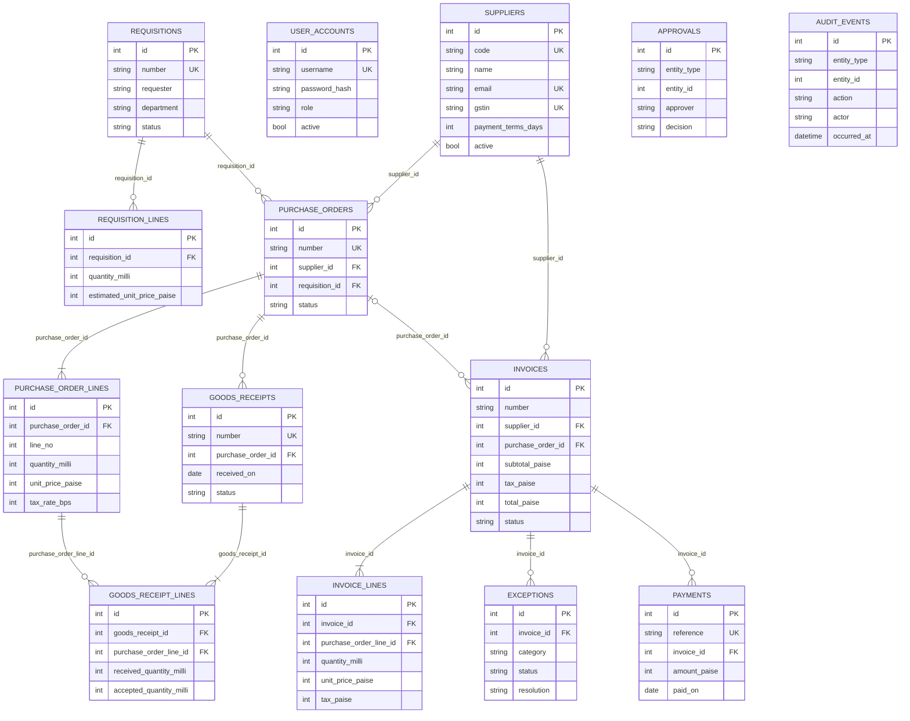

# Database design

The application uses SQLite for local development. Integer identifiers are primary keys; declared foreign keys use restrictive deletion behavior for financial records, and foreign-key columns used for joins are indexed. Invoice number uniqueness is scoped to a supplier. Currency is stored as integer paise, quantities as integer thousandths, and tax rates as integer basis points.

| Table | Purpose |
|---|---|
| `user_accounts` | Local demo username, password hash, role, and active state |
| `suppliers` | Supplier identity, contact, India tax IDs, payment terms, and active flag |
| `requisitions`, `requisition_lines` | Requesting department, business purpose, and requested lines |
| `purchase_orders`, `purchase_order_lines` | Supplier commitment, source request, ordered quantity, price, and tax rate |
| `goods_receipts`, `goods_receipt_lines` | Receipt headers and delivered/accepted/rejected quantities by PO line |
| `invoices`, `invoice_lines` | Supplier invoice source data, match outcome, workflow, tax, and calculated totals |
| `exceptions` | Mismatch category, description, resolution, and timestamps |
| `approvals` | Requisition, PO, and invoice approval decisions |
| `payments` | Payment reference, invoice, date, amount, method, and note |
| `audit_events` | Append-oriented business action trail for changed records |

## Migration and database initialization

Alembic migrations live under `backend/migrations`. The initial migration creates the SQLAlchemy metadata. `Base.metadata.create_all()` in the FastAPI lifespan keeps a fresh local checkout runnable; subsequent structural changes should be added as forward Alembic revisions.
