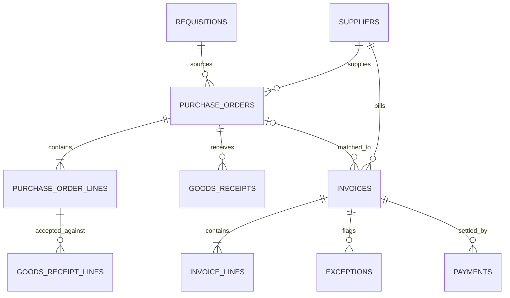

# Procure-to-pay process flow

```mermaid
flowchart LR
  A[Department need] --> B[Requisition submitted]
  B --> C{Department approval}
  C -- Reject --> B
  C -- Approve --> D[Supplier and purchase order]
  D --> E{PO approval and release}
  E -- Reject --> D
  E -- Release --> F[Goods receipt]
  F --> G[Accepted / rejected quantities]
  G --> H[Supplier invoice]
  H --> I{Two-way or three-way match}
  I -- Exception --> J[Investigate and correct source data]
  J --> I
  I -- Clean --> K[Finance approval]
  K -- Reject --> L[Rejected invoice]
  K -- Approve --> M[Payment(s)]
  M --> N[Reconciliation]
```


